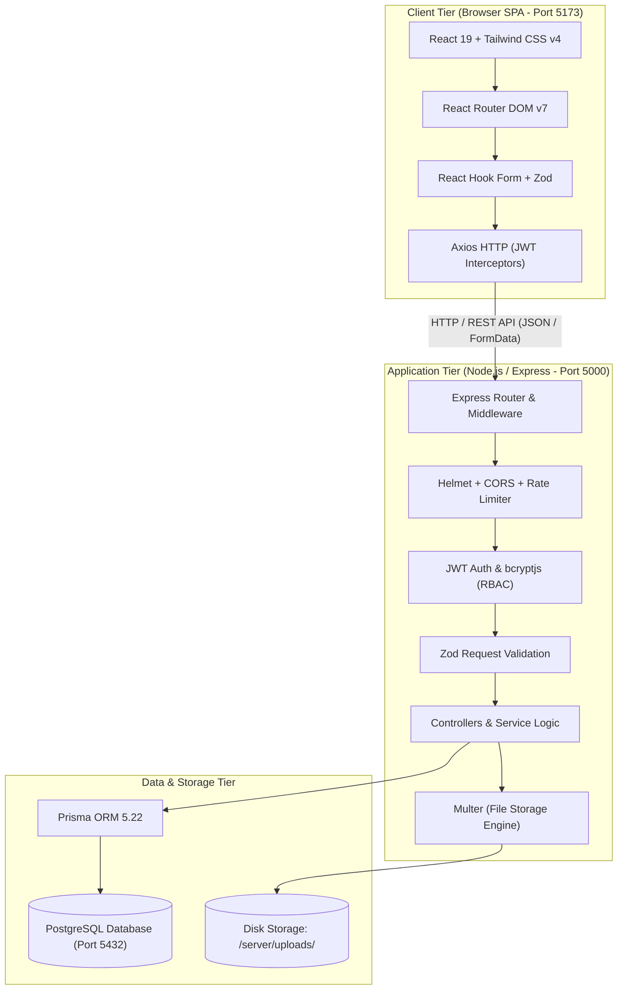

# 🛠️ Technology Stack Specification Document

**Project Name:** Centralized Student Portfolio Management & Discovery Platform  
**Course Context:** MCA Semester 1 — Web Application Development (WAD)  
**Date:** November 2026  
**Document Version:** 1.0.0  

---

## 1. Executive Summary & Architecture Overview

The **Centralized Student Portfolio Management & Discovery Platform** is an enterprise-grade academic portfolio system architected with a modern, decoupled client-server model. It enables students to showcase verified academic accomplishments, faculty to audit and verify supporting documentation, and recruiters/visitors to search and discover talent.

The system is organized into three distinct tiers:
1. **Presentation Tier (Client):** A Single Page Application (SPA) built with React 19, Vite, and Tailwind CSS.
2. **Application Tier (Server):** A RESTful API engine powered by Node.js, Express.js, and Prisma ORM.
3. **Data Tier (Persistence):** Relational PostgreSQL database managed via Prisma with zero-config embedded local engine capability.

---

## 2. Frontend Technology Stack (Client)

The frontend is located under `client/` and is designed as an interactive Single Page Application (SPA).

| Component / Layer | Technology | Version | Purpose & Rationale |
| :--- | :--- | :--- | :--- |
| **UI Library** | **React** | `^19.3.1` | Declarative, component-based user interface framework utilizing modern React 19 concurrent features and hooks. |
| **DOM Renderer** | **React DOM** | `^19.3.1` | Connects React virtual DOM elements to browser DOM. |
| **Build & Dev Tool** | **Vite** | `^8.3.4` | Ultra-fast native ESM-powered bundler providing near-instantaneous Hot Module Replacement (HMR). |
| **Vite Compiler Plugin** | **@vitejs/plugin-react** | `^6.1.2` | Fast Refresh and Babel/OXC JSX transforms for Vite. |
| **Styling Engine** | **Tailwind CSS** | `^4.3.3` | Utility-first CSS framework delivering responsive, performant, and maintainable styling. |
| **Tailwind Vite Plugin** | **@tailwindcss/vite** | `^4.3.3` | Native build-time integration for Tailwind CSS v4. |
| **Client-Side Routing** | **React Router DOM** | `^7.18.4` | Client-side routing, nested routes, and Role-Based Access Control (RBAC) route guards. |
| **Form Management** | **React Hook Form** | `^7.91.0` | High-performance, re-render-minimized form handling for complex portfolio profiles. |
| **Client Validation** | **Zod** | `^4.6.7` | Static type inference and runtime schema validation for user forms. |
| **Form Resolvers** | **@hookform/resolvers** | `^3.10.0` | Seamless bridge connecting Zod validation schemas with React Hook Form. |
| **HTTP Client** | **Axios** | `^1.20.0` | Promise-based HTTP client configured with request/response interceptors for Bearer token injection and error handling. |
| **Iconography** | **Lucide React** | `^1.61.0` | Modern, clean, and lightweight SVG icons for portfolio items, verification badges, and navigation. |
| **Static Code Linter** | **Oxlint** | `^1.88.0` | High-speed Rust-based JavaScript and React linter ensuring code quality and best practices. |

---

## 3. Backend Technology Stack (Server)

The backend is located under `server/` and provides a modular RESTful API architecture following standard Controller-Route-Service patterns.

| Component / Layer | Technology | Version | Purpose & Rationale |
| :--- | :--- | :--- | :--- |
| **Runtime Environment** | **Node.js** | `≥ 18.0.0` | Asynchronous, event-driven JavaScript server runtime executing ES Modules (`"type": "module"`). |
| **Application Framework** | **Express.js** | `^4.21.1` | Lightweight, robust web framework providing routing, middleware integration, and REST primitives. |
| **Data Modeling & ORM** | **Prisma ORM** | `^5.22.0` | Type-safe database client (`@prisma/client`) and automated migration toolkit (`prisma`). |
| **Payload Validation** | **Zod** | `^3.23.8` | Backend request payload schema validation, sanitizing inputs before reaching business logic. |
| **Session & Token Auth** | **jsonwebtoken (JWT)** | `^9.0.2` | Generates and verifies cryptographically signed bearer tokens for stateless user sessions. |
| **Password Hashing** | **bcryptjs** | `^2.4.3` | Salted cryptographic password hashing preventing credential leaks. |
| **HTTP Security Headers** | **Helmet** | `^8.0.0` | Sets secure HTTP headers (XSS filter, Clickjacking defense, HSTS, Sniff protection). |
| **CORS Middleware** | **cors** | `^2.8.5` | Regulates cross-origin requests between the Vite frontend (`:5173`) and Express backend (`:5000`). |
| **Rate Limiter** | **express-rate-limit** | `^7.4.1` | Protects authentication and public API endpoints against brute-force attacks and abuse. |
| **Multipart Uploads** | **Multer** | `^1.4.5-lts.1` | Handles incoming binary file uploads (profile avatars, verification proofs, certificates). |
| **CSV Processing** | **csv-parser** | `^3.0.0` | Parses institutional bulk CSV files for batch onboarding of student/staff accounts. |
| **HTTP Request Logger** | **Morgan** | `^1.10.0` | Request logging middleware detailing HTTP method, route, status code, and latency. |
| **Configuration** | **dotenv** | `^16.4.5` | Zero-dependency environment variable loader from `.env` files. |
| **Dev Live-Reload** | **Nodemon** | `^3.1.7` | Developer tool monitoring backend source changes and automatically restarting the Node process. |
| **Unit & Integration Test**| **Node.js Test Runner** | Built-in | Native test runner (`node --test`) executing API endpoint and authentication test suites. |

---

## 4. Database & Storage Tier

| Component | Technology | Specification / Configuration |
| :--- | :--- | :--- |
| **Database Engine** | **PostgreSQL** | Relational SQL database engine supporting transactions, foreign key integrity, and relational joins. |
| **Zero-Config Runner** | **embedded-postgres** (`^18.4.0-beta.17`) | Self-contained PostgreSQL binary automatically initialized inside `server/.pgdata` without manual database installation. |
| **ORM / Migration** | **Prisma 5.22** | Declarative schema file (`schema.prisma`), database push (`prisma db push`), and automatic TypeScript/JS client generation. |
| **Database Seeding** | **Custom Seeder (`seed.js`)** | Populates baseline roles, sample academic departments, batches, administrators, faculty, and student profiles. |
| **Blob / File Storage** | **Local File System** | Storage under `server/uploads/` with MIME-type segregation and file size constraints: |
| | *Images (Avatars/Banners)* | Allowed: `image/jpeg`, `image/png`, `image/webp` (Max Size: 2 MB) |
| | *Certificates/Evidence* | Allowed: `application/pdf` (Max Size: 5 MB) |

---

## 5. Security & Authentication Architecture

* **Authentication Protocol:** JSON Web Tokens (JWT) using `HS256` symmetric signing algorithm.
* **Access Control:** Role-Based Access Control (RBAC) partitioned across 4 access tiers:
  * `PUBLIC`: Discovery, search, and publicly approved portfolios.
  * `STUDENT`: Self-service profile, project, skill, and evidence upload management.
  * `STAFF`: Verification queues, document verification (Approval/Rejection/Resubmission) with audit trails.
  * `ADMIN`: User provisioning, role assignment, password resets, and system-wide monitoring.
* **Password Policy:** Irreversible password salting and hashing using `bcryptjs` (salt rounds configured for optimal cryptographic security).
* **Input Sanitization & Type Safety:** Dual-layer validation (client-side form validation + server-side Zod validation schemas) preventing SQL injection, mass assignment, and type confusion.

---

## 6. Development, Automation & Tooling Scripts

* **`start-dev.bat`:** Windows batch automation that concurrently spawns backend and frontend instances in two synchronized terminal windows.
* **`start-dev.ps1`:** Native PowerShell startup script checking execution environments, starting services, and reporting port mappings.
* **`server/scripts/pg-start.js`:** Dedicated initialization script for starting the embedded PostgreSQL daemon.
* **`npm run dev` / `npm start`:** NPM lifecycle scripts orchestrating Vite development and Node execution.

---

## 7. System Prerequisites & Environment

* **Node.js:** `v18.x` or higher
* **Package Manager:** `npm` (v9.x or higher)
* **Operating System:** Platform independent (Windows, macOS, Linux supported; native launch scripts tailored for Windows)
* **Default Ports:**
  * **Frontend Client:** `http://localhost:5173`
  * **Backend API:** `http://localhost:5000`
  * **PostgreSQL Engine:** `localhost:5432`
